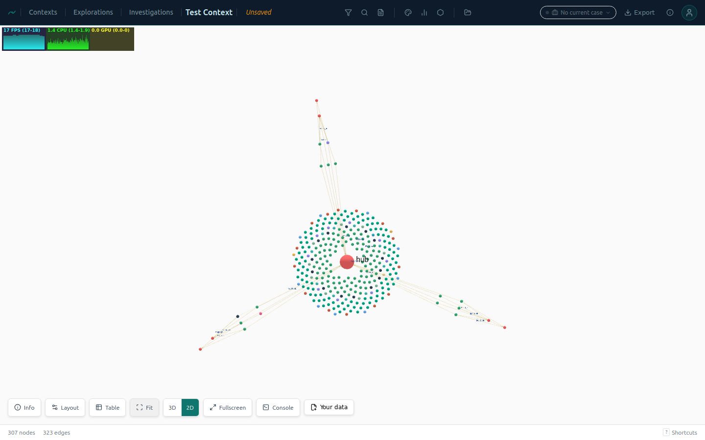
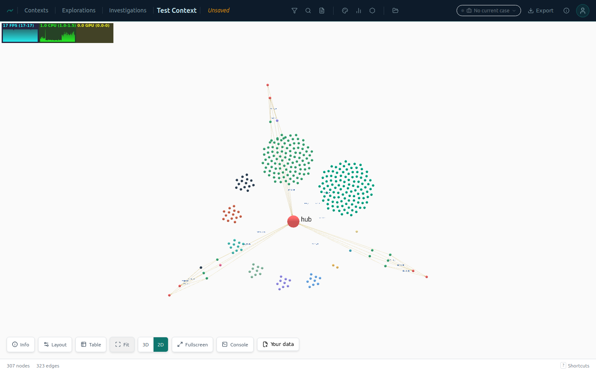

# 05 · Estratégias de visualização, com ou sem agrupamento, com ou sem ocultação

> Correção de rumo de 2026-11-13. Os documentos 02 a 04 foram escritos em torno da coleção (um cluster fechado), porque essa máquina já existe no código. Isso estreitou a pergunta: **nenhuma das estratégias abaixo, exceto a última, exige calcular um cluster antes.**
> Este documento reorganiza as opções por dois eixos independentes e refaz a recomendação. Onde ele discorda do 02 ou do 04, vale este.

## O que precisa ser calculado, de fato

| Para… | Basta ter | Já existe? |
|---|---|---|
| Saber quem é hub e quem é folha de um hub | O grau de cada nó e o vizinho único da folha | Sim: `nodeDegrees` e `adjacencyList` em `stores/graph.ts`, recalculados quando as arestas mudam |
| Ordenar ou separar folhas por papel | O valor de uma propriedade do nó ou da aresta | Sim, é leitura de propriedade |
| Decidir o que desenhar em cada zoom | Pixels por unidade de mundo, na câmera parada | Sim: é o que `useGraphLabels.ts` calcula a cada parada de câmera (300 ms) |
| Colapsar um grupo num único nó que abre | Um `Cluster` com id, estado e persistência | Sim, mas **só é necessário para isto** |

Nada disso é um passo do usuário nem uma execução de programa. É derivado do grafo carregado, em tempo linear nas arestas.

## Os dois eixos

|  | **Não oculta nada** | **Oculta conforme o zoom ou o foco** |
|---|---|---|
| **Não agrupa** | E1 arranjo das folhas · E2 arestas implícitas · E3 glifo por zoom | E5 revelar por zoom · E6 foco e contexto |
| **Agrupa só na aparência** | E4 pétalas e rótulos de região | E5 com orçamento por região |
| **Agrupa nos dados** | — | E7 coleção fechada que abre (o que o 03 descreve) |

## Protótipo sem cluster

Mesma fixture (hub + 300 sócios), nenhuma coleção, nenhum programa. Uma função posiciona as folhas em torno do hub e as arestas hub–folha deixam de ser desenhadas, porque a posição já diz a ligação.

| Coroa: folhas em espiral em torno do hub | Pétalas: um disco por papel |
|---|---|
|  |  |

[Pétalas, aproximado](screens/14-sem-cluster-petalas-300-zoom.png): cada ponto é um nó real, selecionável, com a cor do seu tipo.

O que o protótipo mostrou:

- A proporção entre papéis se lê de relance nas pétalas (dois grupos grandes e vários pequenos), sem rótulo e sem contagem. É o que a área faz.
- Os 15 sócios com outro vínculo continuam soltos, com suas arestas, e passam a ser **as únicas arestas na tela**.
- A coroa ocupa um raio de 148 unidades para 285 folhas com espaçamento 14 (seriam ≈ 275 com o espaçamento 26 que o ego usa). O anel do ego de hoje ocupa ≈ 1240.
- No protótipo, os nós que não são folha não se afastaram para dar lugar (ficaram por cima das pétalas). Numa implementação, o layout tem de reservar o espaço.
- Rótulos de aresta continuaram aparecendo para arestas não desenhadas: artefato do protótipo, mas é um item a tratar.

## E1 · Arranjo das folhas (não agrupa, não oculta)

**O que é.** Uma função pura que posiciona as folhas de cada hub: em coroa (espiral em torno do hub) ou em pétalas (um disco por valor de propriedade, dispostos em volta do hub). Mesma matemática da seção 7 do [03](03-design.md).

**Como fazer aqui.**

- Função em `utils/` (irmã: `computeTreeLayout` em `utils/layoutModes.ts`), testável sem Vue.
- No force layout, as folhas arranjadas não participam da simulação como corpos livres: uma força própria, registrada por último, recoloca cada folha em `posição do hub + deslocamento` a cada tick. Precedentes de força própria: `applyCommunityRadialForce` e `applyEdgeTypeLayoutForce` em `utils/forceConfig3D.ts`. A carga das folhas continua empurrando os outros nós, o que reserva o espaço.
- No ego layout, é a mesma função aplicada ao anel 1; substitui os sub-anéis para o caso das folhas.
- Configuração em `layout_mode_config` (dict livre em `schemas.py`, sem migração): `hubLeaves: 'free' | 'crown' | 'petals'`, propriedade de ordenação, limiar de hub.

**Trade-offs.**

| Ganha | Paga |
|---|---|
| Todo nó continua na tela, selecionável, com cor e métrica | Não reduz o número de objetos; custo de desenho dos nós igual ao de hoje |
| Determinístico: mesma entrada, mesma figura | As folhas deixam de responder às forças; arrastar uma folha não faz sentido |
| Raio cresce com √N | Acima de alguns milhares por hub, vira uma mancha |
| A simulação fica mais barata (as folhas não são corpos livres) | A força própria precisa existir também no settle headless (`utils/headlessLayout.ts` espelha as forças à mão) |

**Veredito: fazer primeiro.** É a resposta que não depende de agrupamento nem de ocultação.

## E2 · Arestas implícitas (não agrupa; oculta tinta, não dado)

**O que é.** Com as folhas coladas ao hub, a aresta hub–folha não é desenhada. Ela reaparece ao passar o mouse ou selecionar a folha ou o hub.

**Como fazer aqui.** Um motivo a mais de "não desenhar" em `computeLinkAppearance` (`utils/graphAppearance.ts`), que já decide `hidden` por aresta sem reconstruir a cena. A lente de arestas (`edgeLensMode`) já reexibe por foco.

**Trade-offs.**

| Ganha | Paga |
|---|---|
| Remove a maior fonte de tinta: 285 de 323 arestas na fixture | Propriedade da aresta (percentual, data) só aparece no foco ou na tabela |
| As arestas que sobram são as que importam | Uma captura para relatório não mostra as arestas: precisa de uma marca visível ("285 arestas ao hub não desenhadas") |
| Menos geometria: no headless por software, de ~11 para ~17 quadros por segundo (medida relativa, não de produção) | Rótulos de aresta têm de seguir a mesma regra |

Não é bundling: nenhuma aresta é desviada nem fundida, e nenhuma ligação que não existe é sugerida.

**Veredito: fazer junto com E1**, com a marca visível e um botão para desenhar todas.

## E3 · Glifo por zoom (não agrupa, não oculta)

**O que é.** O mesmo nó muda de representação conforme o tamanho em tela: ponto, depois nó, depois nó com ícone e rótulo.

**O que já existe e como se comporta.** Só rótulos têm nível de detalhe. Medido na sonda, com o degree dim desligado:

| Zoom da câmera | Rótulos de folha |
|---|---|
| 6,4 (dois passos de roda a partir do encaixe; o *Fit* limita o zoom a 6) | [nenhum](screens/15-rotulos-zoom-6.png) |
| 11,4 | [todos de uma vez](screens/16-rotulos-zoom-11.png) |

Ou seja, o zoom **já revela**, mas num degrau só, e com o degree dim ligado (o padrão) os rótulos saem a 20% de opacidade. Não há prioridade entre folhas porque todas têm o mesmo tamanho.

**Como fazer aqui.** No gancho de câmera parada (`useGraphCamera.ts`), calcular o nível a partir de pixels por unidade e aplicá-lo em `updateVisuals()` (tamanho do nó, ícone ligado ou não). Para rótulos, dar uma ordem estável de desempate (propriedade, depois id) para que apareçam aos poucos.

**Trade-offs.** Não esconde nada. O risco é a troca de nível piscar; resolve-se com histerese. Em 3D usa-se o raio em tela do nó, que o LOD de rótulos já calcula.

**Veredito: fazer**, começando por tornar gradual a revelação de rótulos.

## E4 · Pétalas e rótulos de região (agrupa só na aparência)

**O que é.** As folhas são separadas por valor de uma propriedade em regiões vizinhas, e cada região recebe um rótulo com nome e contagem ("114 Sócio PF"). Não existe objeto de grupo: é ordenação mais anotação.

**Como fazer aqui.** A contagem é um `group by` sobre as folhas. O rótulo é uma entrada sintética no renderizador de rótulos, sempre visível (o mesmo mecanismo dos rótulos forçados de seleção e hover em `useGraphLabels.ts:187`). Opcionalmente, um círculo translúcido por região.

**Trade-offs.**

| Ganha | Paga |
|---|---|
| Responde "quantos de cada tipo" sem esconder ninguém | Exige escolher a propriedade; propriedade com muitos valores distintos gera regiões demais |
| Nada a persistir além da configuração do layout | Contornos sobrepostos custam acerto [26 do 01]; as regiões não podem se sobrepor |

**Veredito: fazer**, como modo "pétalas" de E1.

## E5 · Revelar por zoom (não agrupa, oculta)

**O que é.** Longe, aparecem o hub, os vizinhos com outro vínculo e os k primeiros de cada região; o resto vira uma marca ("+270"). Aproximar revela mais. É o modelo do GraphMaps [17 do 01].

**Por que isto é viável aqui, ao contrário do que o 02 dizia.** A objeção do 02 (caso 4C) era contra abrir e fechar *clusters* pelo zoom, porque isso muda a contagem de nós e reconstrói a cena. Revelar por zoom **sem cluster** não tem esse problema: todos os nós ficam na cena e no layout; só o sinalizador `hidden` muda, pelo caminho visual que já existe para filtros (contrato em `stores/graph.ts:1052`: esconder sem reconstruir e sem mexer em posição). Com E1, cada folha oculta tem lugar reservado, então nada se move quando ela aparece.

**Como fazer aqui.**

- Cada folha recebe um nível de revelação a partir de uma ordem: resultado de busca e seleção primeiro, depois a métrica ou propriedade escolhida, depois o id.
- Na câmera parada, o orçamento por célula de tela decide quantas aparecem. É a mesma grade que já limita rótulos (`utils/LabelGrid.ts`, rótulos por célula proporcionais ao quadrado do zoom).
- Um motivo a mais de `hidden` em `computeNodeAppearance`.
- A marca "+N" por hub ou por região é obrigatória e sempre visível.

**Trade-offs.**

| Ganha | Paga |
|---|---|
| É o que o pedido original descreve: o zoom libera mais nós | Contraria a regra "nada escondido em silêncio" (2026-07-20), a menos que a marca "+N" seja aceita como aviso suficiente. **Decisão de produto (D7)** |
| Custo de desenho cai de verdade quando longe | Se as folhas não têm nada que as ordene, a escolha de quem aparece primeiro é arbitrária |
| Sem reconstrução, sem movimento | Uma captura tirada de longe omite nós; a marca tem de sair na captura |
| | Histerese e transição suave para não piscar; em 3D o gatilho é raio em tela, não "nível" |

**Alternativa sem ocultar:** em vez de `hidden`, os de nível baixo viram ponto de 1 a 2 px (é E3). Perde o ganho de desempenho, mantém a regra.

**Veredito: viável e barato depois de E1; depende de D7.** Entregar como opção desligada por padrão.

## E6 · Foco e contexto (não agrupa, oculta pelo foco)

Já existe: lente de arestas (`edgeLensMode` ocultar ou esmaecer), profundidade de foco, degree dim com "preservar pontes", "mostrar só". O que falta é pequeno: ao passar o mouse sobre uma região de pétalas, destacar a região e suas arestas. Fazer junto com E2.

## E7 · Coleção fechada que abre (agrupa nos dados)

É o que os documentos 02 a 04 descrevem. Continua válida, mas muda de papel: deixa de ser o núcleo e passa a ser **uma redução opcional por cima do arranjo**, útil em três situações.

| Situação | Por quê |
|---|---|
| Hub com milhares de folhas | E1 vira mancha; só reduzir objetos resolve |
| Relatório ou visão geral com vários hubs | Um nó com "114 Sócio PF" lê melhor que um disco |
| Anel do ego com muitos tipos | Um nó por tipo no anel |

Com E1 pronto, a coleção fica mais simples: **uma coleção é uma pétala colapsada**, com a mesma chave e no mesmo lugar. O estado "empacotado" (fase F5 do 04) deixa de existir como fase: é o próprio E4.

## Recomendação revista

| Ordem | Entrega | Agrupa? | Oculta? |
|---|---|---|---|
| 1 | **E1 + E2 + E4**: arranjo das folhas em coroa ou pétalas, arestas implícitas com marca, rótulo de região com contagem | Só na aparência | Só tinta |
| 2 | **E3**: rótulos revelados aos poucos; glifo por zoom | Não | Não |
| 3 | Consertos F0 e expansão seletiva F3 do [04](04-plano-de-implementacao.md) | — | — |
| 4 | **E5**: revelar por zoom, opcional, se D7 for sim | Não | Sim, com marca |
| 5 | **E7**: colapsar uma pétala num nó (F1 do 04, reduzida) | Sim | Até abrir |

A fase correspondente no plano é a **FV**, no [04](04-plano-de-implementacao.md#fv--arranjo-visual-das-folhas-sem-agrupamento).

## O que muda nas decisões

- **D3** (construir o estado empacotado) deixa de ser decisão: vira a primeira entrega, sem cluster.
- **D7 (nova): ocultar nós conforme o zoom é aceitável se houver uma marca "+N" sempre visível?** Sim libera E5. Não mantém E3 como teto.
- **D8 (nova): arestas hub–folha não desenhadas por padrão no arranjo?** Recomendação: sim, com marca e botão.
