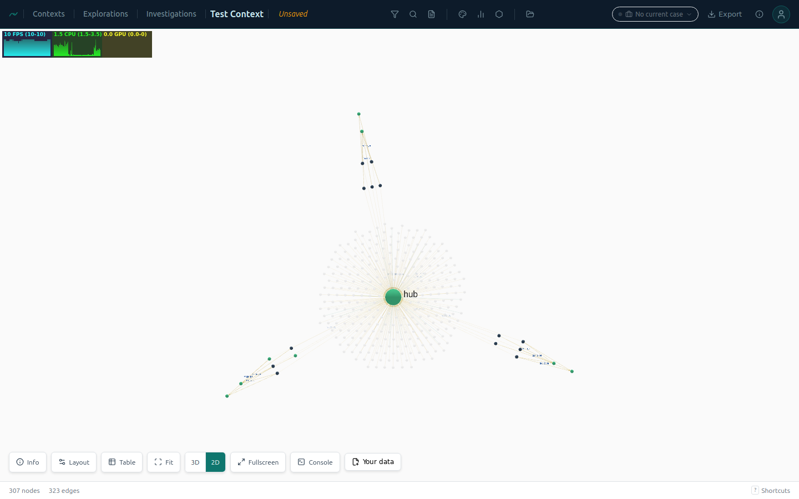
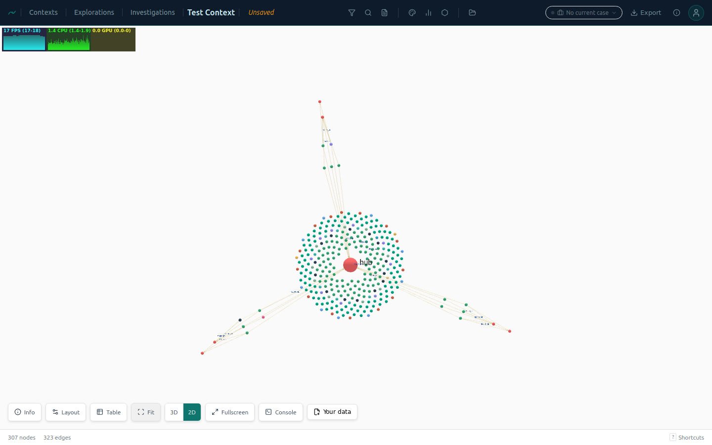
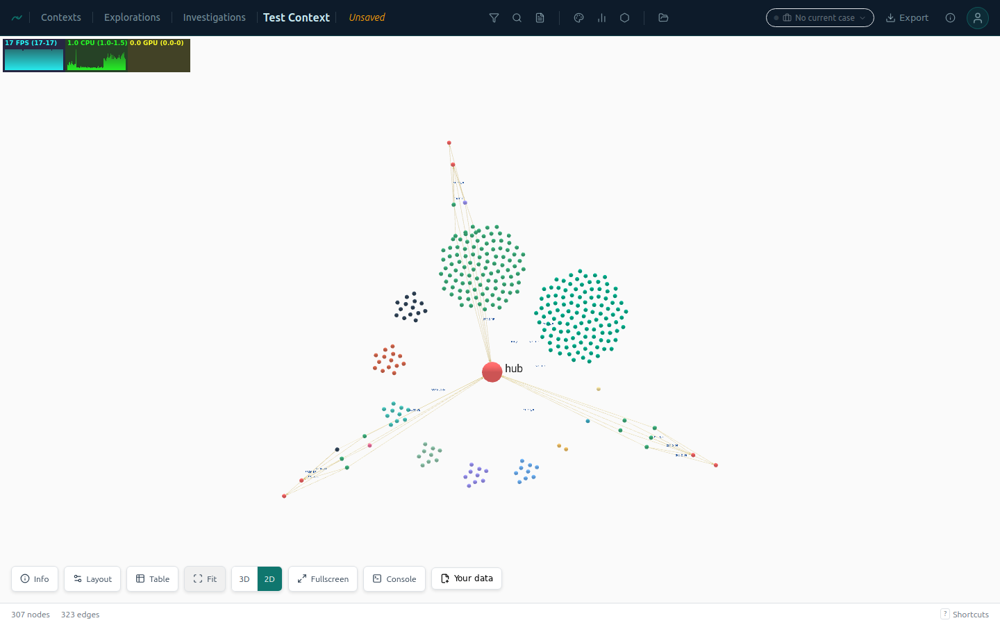
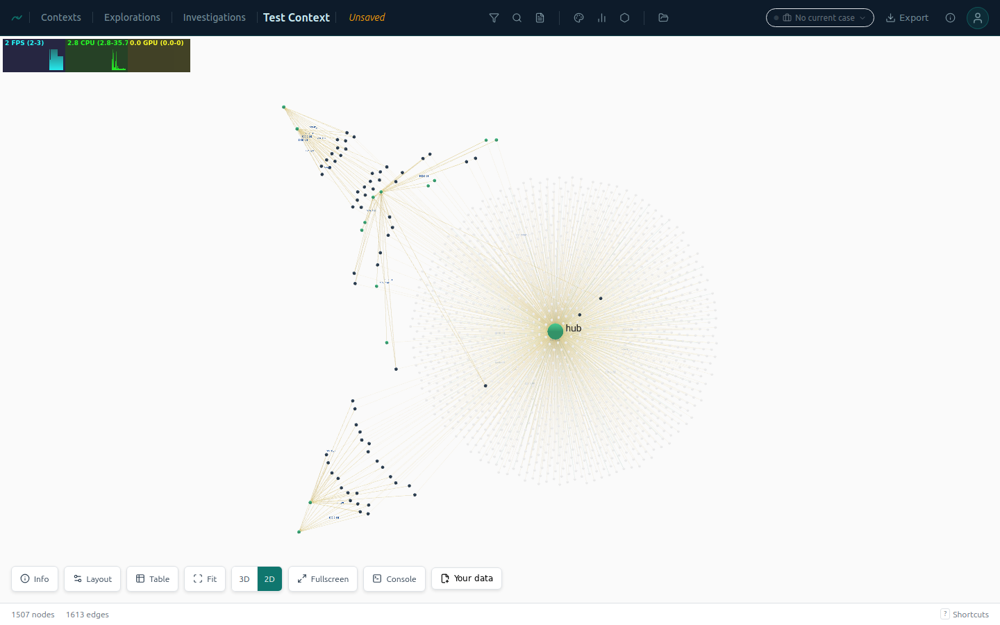
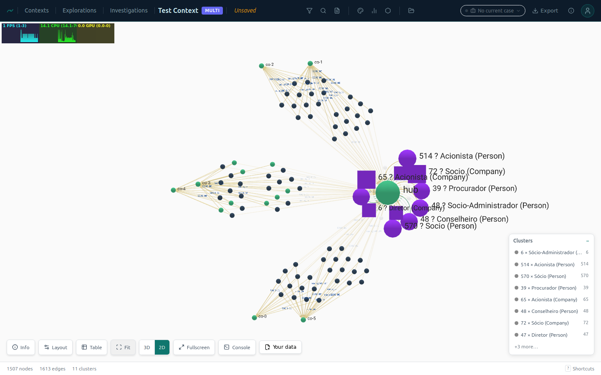

# Hubs densos: um nó com centenas de vizinhos diretos

> Status: **proposta** (nada implementado). Análise de 2026-11-13, branch `feature/context-look-clusters`.
> Pasta fora do site VitePress (`srcExclude: dev/**`).
> Incorpora e amplia [ego-crowded-rings-qsa.md](../ego-crowded-rings-qsa.md) (2026-08-28), que tratava só do layout ego e não foi implementado.

## O problema

Num grafo egocêntrico em que um nó se liga direto a centenas de outros (o quadro societário de uma empresa grande), a tela vira um disco de pontos, mesmo com force layout. O investigador quer saber três coisas e a tela não responde nenhuma:

1. Quantos vizinhos são, e de que tipo e papel.
2. Quais deles têm **outro** vínculo (quase sempre o alvo).
3. Quem é um vizinho específico, sem perder o conjunto de vista.

## A resposta em uma frase

As folhas de um hub são **arranjadas junto dele** (em coroa, ou em pétalas por papel), suas arestas ao hub deixam de ser desenhadas e o zoom vai nomeando cada uma; quem tem outro vínculo fica solto, com as únicas arestas da tela. **Isso não exige calcular cluster nenhum**: basta o grau de cada nó, que já existe. Colapsar uma pétala num nó que abre é uma redução opcional por cima, para hubs de milhares.

> **Correção de rumo (2026-11-13).** A primeira versão deste pacote punha a coleção (um cluster fechado) no centro, porque essa máquina já existe no código. A pergunta é mais ampla: estratégias de visualização que podem ou não agrupar e podem ou não ocultar. O [05](05-estrategias-de-visualizacao.md) reorganiza as opções por esses dois eixos, traz um protótipo sem cluster e refaz a recomendação. Onde o 05 discorda do 02, do 03 ou do 04, vale o 05.

## O que a sonda mostrou

Sem agrupar nem ocultar (300 sócios; só posição, e arestas hub–folha não desenhadas):

| Hoje | Coroa | Pétalas por papel |
|---|---|---|
|  |  |  |

Com agrupamento nos dados (1500 sócios; clusters fechados):

| Hoje | Com coleções (protótipo, sem mudar o código do app) |
|---|---|
|  |  |
| 1507 nós: disco de ~1420 folhas esmaecidas, sem nome nem contagem | Os mesmos dados: 11 coleções nomeadas + 75 sócios com outro vínculo + 6 holdings |

O protótipo também expôs o que falta para isso ser produto: sem rótulo no zoom de encaixe, tamanho que satura, leque de arestas paralelas, coleção aberta sem rastro, e tudo se perde ao expandir um nó. Detalhe em [00-diagnostico.md](00-diagnostico.md).

## Resposta por caso

| Caso | Resposta recomendada | Fase |
|---|---|---|
| Caso | Resposta recomendada | Agrupa? | Oculta? | Fase |
|---|---|---|---|---|
| **Force layout** com a estrela carregada | Folhas arranjadas junto ao hub (coroa ou pétalas por papel); arestas hub–folha implícitas, com marca; rótulo de região com contagem | Só na aparência | Só tinta | FV |
| **Zoom que revela** | Rótulos aos poucos e glifo por zoom; como opção, revelar nós por zoom com marca "+N" | Não | Opcional (D7) | FZ |
| **Colapsar e explodir** | Uma pétala colapsa num nó com contagem e abre no mesmo lugar | Sim | Até abrir | F1 |
| **Ego layout** | A mesma função arranja o anel 1; coleção fechada vira um nó do anel | Opcional | Não | F0.1, F4 |
| **Chegada**: o hub ainda não foi carregado | Contar vizinhos por tipo antes de carregar; acima de 50, diálogo de expansão seletiva; selo "carregados N de M" | — | — | F0.5, F3 |
| **3D** | Arranjo só em 2D na primeira versão; em 3D a opção oferece mudar | — | — | FV |
| **Consultar a lista** | Resumo de vizinhos no painel do nó; lista de membros de uma região | — | — | F2 |

Rejeitado, com motivo em [02](02-opcoes-e-tradeoffs.md): filtrar por grau, edge bundling, esmaecer por densidade, fisheye, agrupar vizinhos que têm outros vínculos, e abrir e fechar *clusters* sozinho pelo zoom. Revelar *nós* por zoom, sem cluster, saiu da lista de rejeitados: é viável e depende de D7.

## Ordem de leitura

| # | Arquivo | Para quê |
|---|---|---|
| 1 | Este README | Problema, resposta, decisões em aberto |
| 2 | [00-diagnostico.md](00-diagnostico.md) | O que a tela faz hoje (11 capturas), o que já existe no código, 16 lacunas, restrições de produto |
| 3 | [01-referencias.md](01-referencias.md) | Literatura com resultados medidos; o que Maltego, GraphXR, Linkurious, KeyLines e outros entregam |
| 4 | [02-opcoes-e-tradeoffs.md](02-opcoes-e-tradeoffs.md) | Opções por caso, com o que cada uma esconde e quanto custa aqui |
| 5 | [03-design.md](03-design.md) | Modelo, regra, estados, aparência, interação, API de contagem |
| 6 | [04-plano-de-implementacao.md](04-plano-de-implementacao.md) | Fases FV, FZ e F0 a F6 com critérios de aceitação, arquivos, verificações, portões e riscos |
| **2º a ler** | [05-estrategias-de-visualizacao.md](05-estrategias-de-visualizacao.md) | **O mapa revisto**: estratégias por dois eixos (agrupa? oculta?), protótipo sem cluster, recomendação atual |
| — | [screens/](screens/) | Capturas da sonda |
| — | [../ego-crowded-rings-qsa.md](../ego-crowded-rings-qsa.md) | Especificação dos sub-anéis do ego (fase F4) |

## Decisões em aberto

Cada uma tem recomendação; o plano segue a recomendação até alguém decidir o contrário.

| # | Decisão | Opções | Recomendação | Trava |
|---|---|---|---|---|
| D1 | O que dispara o agrupamento | (a) aviso com botão; (b) automático acima do limiar, por contexto; (c) só manual | **(a)**, com (b) disponível como behavior de contexto, desligado por padrão. Automático troca a tela sem pedido | F1 |
| D2 | Clique numa coleção fechada | (a) manter: abre o modal de membros; (b) clique seleciona, duplo clique abre e fecha (KeyLines, Linkurious) | **(a) em F1**; reavaliar (b) com o `ux-reviewer` depois de F2. Trocar agora muda um gesto que os usuários de clusters já conhecem | F1 |
| D3 | ~~Construir o estado empacotado~~ | — | **Resolvida pelo 05**: vira o modo pétalas da FV, sem cluster, e é a primeira entrega | — |
| D4 | Agrupar também por propriedade (papel do sócio) | (a) só tipo de vínculo e de nó; (b) propriedade escolhida no painel de vizinhos; (c) propriedade padrão por contexto | **(a) em F1, (b) em F2.** No protótipo, a propriedade foi o que deu significado aos grupos | F2 |
| D5 | O que a coleção afirma | (a) "ligados só ao hub **entre os nós carregados**"; (b) consultar o grau real de cada membro na base | **(a) agora**; (b) como experimento de F6. Um membro-folha pode ter dezenas de vínculos que ainda não vieram | F1 |
| D6 | Limiares iniciais | hub = grau > 30; coleção ≥ 5 membros; diálogo de expansão > 50 arestas | Começar com esses e calibrar olhando a tela com dado real | F1, F3 |
| **D7** | Ocultar nós conforme o zoom | (a) não: longe, a folha vira ponto, mas nunca some; (b) sim, com marca "+N" sempre visível, inclusive em captura | **É sua.** A regra de 2026-07-20 ("nada escondido em silêncio") foi escrita para filtros; (b) só entra se a marca for aceita como aviso suficiente. Sem resposta, o plano fica em (a) | FZ |
| **D8** | Arestas hub–folha não desenhadas no arranjo | (a) implícitas por padrão, com marca e botão para desenhar; (b) sempre desenhadas, esmaecidas | **(a)**. São 285 de 323 arestas na fixture, e a posição já diz a ligação | FV |

## Regras de trabalho

- Nada de dado escondido em silêncio. Toda agregação mostra contagem e pode ser aberta. (`decision_log`, 2026-07-20.)
- O arranjo das folhas não cria entidade nenhuma: é posição e aparência derivadas do grau. Quando houver colapso num nó, a coleção é um `Cluster`; não criar um segundo conceito de grupo.
- O determinismo do ego layout é requisito.
- Cada fase termina com `verify.sh`, capturas com a fixture do anexo do [04](04-plano-de-implementacao.md) e uma entrada no `decision_log`.
- Números de linha citados são de `0cf9d78`; reencontrar pelo nome da função.
